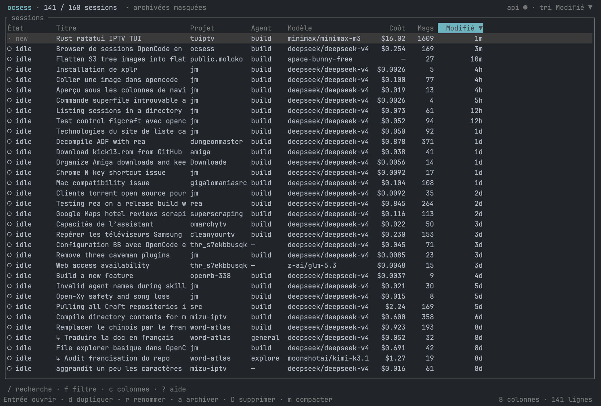

# ocsess

A keyboard-first TUI for browsing and managing OpenCode sessions.



## Features

- Live sessions table: read-only SQLite polling every 700 ms, running state from the OpenCode API every 2 s.
- Works with both OpenCode schema generations: v1 (`session`, `message`, `part`) and v2 (`session_v2`, `session_message`). The layout and columns are detected at load time.
- Sort, global search, per-column filters, show/hide/reorder columns, adjustable widths.
- Open a session directly in its directory with `opencode -s <id> <dir>`.
- Rename, fork, archive, unarchive, delete, and compact sessions.
- Gzip backups before archive and before permanent deletion (including child sessions).
- Per-call detail view: cost, input/output/reasoning/cache tokens, duration, finish reason, and tools used.
- Keyboard-first with mouse parity: click headers, select rows, double-click to open, wheel to scroll.

## Install

Requires Rust 1.89+ and OpenCode.

```bash
cargo build --release
./target/release/ocsess
```

Or install the binary:

```bash
cargo install --path .
```

## Usage

```bash
ocsess                 # TUI
ocsess --dump          # sessions as TSV, no TUI
ocsess --db PATH       # explicit SQLite database
```

The TUI reads `~/.local/share/opencode/opencode.db` in read-only mode. Actions go through the local OpenCode API (`~/.local/state/opencode/service.json`).

## Keys

| Key | Action |
|-----|--------|
| `↑↓` / `j k` | move |
| `gg` / `G` | top / bottom |
| `←→` / `h l` | active column |
| `s` | sort active column |
| `/` | global search |
| `f` | per-column filter (`~` contains, `=` exact, `>N`, `<N`) |
| `F` / `Esc` | clear search and filters |
| `A` | show / hide archived |
| `c` | columns: toggle, width, order |
| `Enter` | open the session in opencode |
| `i` | call detail |
| `d` | duplicate (fork) |
| `r` | rename |
| `a` / `u` | archive / unarchive |
| `D` | delete (gzip backup first) |
| `m` | compact |
| `R` | reload |
| `q` | quit |

Mouse: click a header to sort, click a row to select, double-click to open, wheel scrolls.

## Call detail

Press `i` on a session to see every LLM call:

- Summary: calls, total cost, average cost per call, tools, tool errors, tokens, cache, models.
- Table: time, model, cost, input/output/cache tokens, duration, finish reason, tools used.
- Per-call tools are aggregated (`shell×3`, `read!` when a tool errored).
- Refreshes every 2 seconds while open.

Detail keys: `↑↓` scroll, `g`/`G` newest/oldest, `PgUp`/`PgDn`, `Ctrl+d`/`Ctrl+u`, `R` reload, `i`/`Esc` close.

## Colors

- State: green running, blue suspended, gray idle, magenta archived.
- Cost: green `< $0.05`, yellow `< $0.5`, orange `< $2`, red `>= $2`.
- Updated: cyan for "now", gray for the last week, dim for older.
- Current session: `◆` prefix. Active header: cyan. Sort arrow: yellow.

## Data notes

- The database layout is detected at startup: sessions live in `session_v2` (v2) or `session` (v1), messages in `session_message` or `message`/`part`. Columns missing from the installed schema read as empty instead of failing the query.
- Message counts come from `session_message` (v2) or `message` (v1).
- Per-call usage is stored in the message `data` JSON: `cost`, `tokens.*`, `model.id` (or `modelID`), `finish`, and tool parts — inline in `content` on v2, in the `part` table on v1.
- One assistant message is treated as one LLM call. Retries and streaming chunks are not separate calls.
- If a query fails, the app falls back to `GET /api/session`; `--dump` does the same and reports the fallback on stderr.

## OpenCode compatibility

| OpenCode | Database | API |
|----------|----------|-----|
| v1 | `session`, `message`, `part`, `time_busy` | list/patch/delete/fork/compact |
| v2 | `session_v2`, `session_message` | same routes, payload changed |

Notes for v2 (checked against 2.0.19):

- `time.busy` no longer exists. A session is shown as running when the service lists it in `/api/session/active`; with the service unreachable, an update newer than the idle mark (and less than 15 minutes old) is used as a fallback.
- `/api/session` no longer takes an `archived` filter.
- **Archiving has no write path.** There is no endpoint, and `PATCH` accepts `archived` then ignores it. ocsess asks `/api/info` for the server version at startup: on v2 the `a`/`u` keys are hidden, and pressing them still explains why. Archived data that already exists stays visible through the `A` filter and the Archived column. On v1 the keys work as before.
- Fork, rename, delete, and compact keep working unchanged.

## Files

- Config: `~/.config/ocsess/config.json`
- Backups: `~/.local/state/ocsess/backups/*.json.gz` (directory 700, files 600)

Archiving is native (`time_archived`) and reversible. Permanent deletion always writes gzip backups first.
